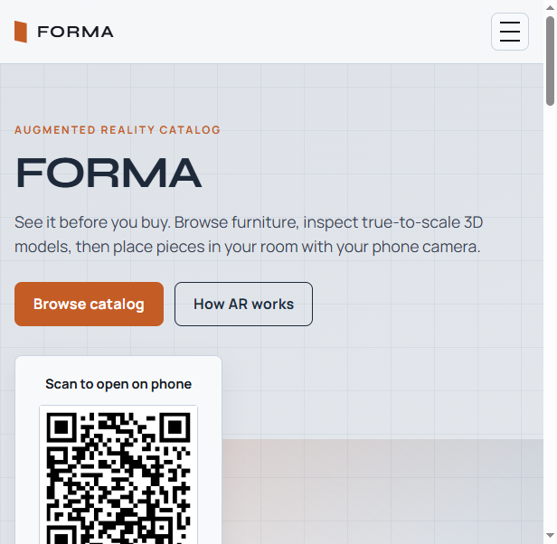
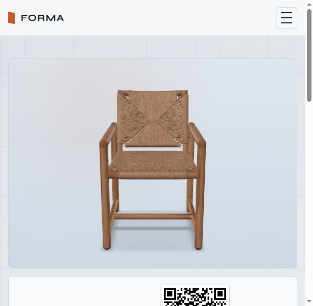
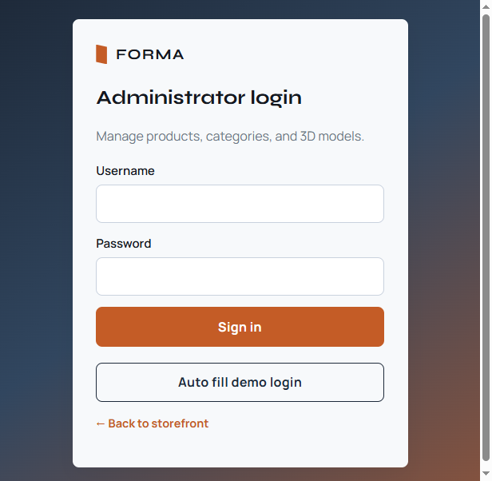

# FORMA — Web-Based AR Furniture Catalog

Professional PHP/MySQL furniture catalog with interactive 3D viewing and mobile Augmented Reality via `<model-viewer>`.



## Screenshots

| Storefront | Product 3D | Admin login |
|------------|------------|-------------|
|  |  |  |

More notes: [`docs/README.md`](docs/README.md)

## Features

- Public catalog with category filters
- Product detail pages with GLB 3D viewer
- AR modes: WebXR, Google Scene Viewer, Apple Quick Look
- Real-world dimensions (cm + optional GLB meters) with **auto-fill from GLB**
- Admin login (password hashing + CSRF) + demo auto-fill button
- Product & category CRUD with secure file uploads
- Dynamic QR codes for desktop → mobile handoff
- Read-only JSON API
- XAMPP and cPanel ready (no Composer/Node required)

## Quick start (XAMPP)

1. Clone this repo into `C:\xampp\htdocs\...`
2. Copy config:
   ```text
   copy config\config.example.php config\config.php
   ```
3. Start Apache + MySQL, import `sql/database.sql`
4. Edit `config/config.php` (DB user/password; optional `base_url` / `lan_ip`)
5. Open: `http://localhost/<your-folder>/`
6. Optional sample GLBs: `php tools/generate_sample_glbs.php`

### Admin (local demo)

- URL: `/admin/login.php`
- Use **Auto fill demo login** on the login page (fields stay empty until you click)
- Change the password before production / cPanel deploy

## Configuration safety

| File | Commit? | Purpose |
|------|---------|---------|
| `config/config.example.php` | Yes | Template |
| `config/config.php` | **No** (gitignored) | Your real DB / URLs / LAN IP |
| `database.example.php` | Yes | PDO example only |
| `sql/database.sql` | Yes | Schema + sample rows |
| `models/*.glb` | **No** | Upload via admin or generate samples |
| `uploads/thumbs/*` | **No** | User uploads |

## cPanel

1. Create MySQL DB + user, import `sql/database.sql`
2. Upload project files
3. Copy `config.example.php` → `config.php` and set DB + `base_url` to your HTTPS domain
4. Ensure `uploads/` and `models/` are writable
5. Test product page + phone AR on HTTPS

## Tech stack

PHP 8+ · MySQL · PDO · Vanilla JS · Bootstrap-free custom CSS · `<model-viewer>`

## License

MIT — see [LICENSE](LICENSE)
